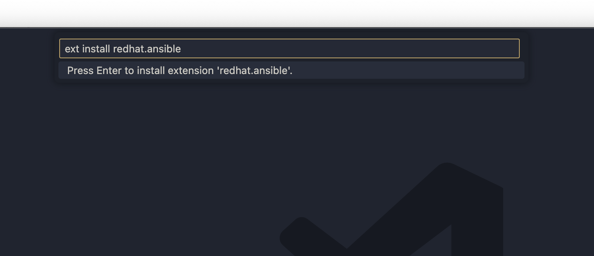

<h1>
  <span class="headline">Infrastructure As Code: Ansible & Terraform</span>
  <span class="subhead">Automating Installations with Ansible Playbooks</span>
</h1>

**Learning objective:** By the end of this lesson, students will be able to automate the installation of tools and dependencies using an Ansible playbook.

## Automating installations with Ansible `playbooks`

In this lesson, you'll learn how to use Ansible, a powerful automation tool, to install essential utilities that will be used in upcoming labs.

Specifically, you’ll set up:

- The **AWS CLI** for managing AWS resources.

- **Terraform** for creating and managing cloud infrastructure.

You'll also explore an Ansible playbook, review its syntax, and execute it to automate the installation process.

## What Are Ansible Playbooks?

Ansible uses **playbooks**, which are structured **YAML** files, to define the steps required to automate tasks.

### Why are they called _"playbooks"_?

The term "playbook" comes from sports, where a playbook outlines a sequence of plays or strategies for the team to execute. Similarly, in Ansible, a playbook is a series of steps or "plays" that a system administrator or developer wants to automate, like installing software, configuring servers, or deploying applications.

### Key components of a `playbook`

| Component       | Description                                                                                      |
| --------------- | ------------------------------------------------------------------------------------------------ |
| **Hosts**       | Defines the systems where the tasks will run.                                                    |
| **Tasks**       | Individual steps executed to achieve the desired state.                                          |
| **Modules**     | Pre-built units of work (ex: install a package, copy a file) that are reusable and customizable. |
| **YAML Format** | Playbooks use YAML, a human-readable data format, to make them easy to write and understand.     |

In this lesson, you'll review and execute a playbook to see how these concepts work in practice.

## 1. Install Ansible

First, we'll need to install Ansible on your machine. Open your terminal and run the following commands.

```bash
sudo amazon-linux-extras install epel -y
```

This command installs the EPEL (Extra Packages for Enterprise Linux) repository on your Amazon Linux instance. EPEL provides additional open-source packages that are not available in the standard Amazon Linux repositories. Many popular software packages, like Ansible, are provided through EPEL.

```bash
sudo yum -y install ansible
```

This command installs Ansible on your Amazon Linux instance.

### Verify the installation

Check that Ansible has been installed and meets the version requirements:

```bash
ansible --version
```

Ensure the version is **2.9.XX** or later.

## 2. Install the VS Code Ansible extension

We can integrate helpful tools in our development environment by adding the Red Hat Ansible extension to VS Code:

1. Open **VS Code**.

2. Press `Ctrl+P` (Windows/Linux) or `Command+P` (Mac) and type:

   ```plaintext
   ext install redhat.ansible
   ```

   <br>

    

    <br>

3. Alternatively, go to the **Extensions** tab in VS Code, search for “Ansible” by **Red Hat**, and click **Install**.
4. Make sure you **restart VS Code** after installation for these packages to load properly.

## 3. Creating an Ansible `playbook`

Now, let's create an Ansible playbook to practice automating configurations. This will give you hands-on experience with Ansible and playbook creation.

### 1. Navigate to the `Desktop` on your workstation and create a new directory.

```bash
cd ~/Desktop
mkdir ansible-demo-01
cd ansible-demo-01
```

### 2. Create the `playbook` file

Create and open a new file called `playbook.yaml` using VS Code:

```bash
code playbook.yaml
```

This is where the magic happens!

### 3. Add starter code

Copy and paste the following code into your `playbook.yaml`:

```yaml
---
- hosts: localhost
   pre_tasks:

  - name: Install dependencies
    ansible.builtin.package:
    name:
  - yum-utils
  - shadow-utils
  - amazon-linux-extras
    become: true

  post_tasks:

  - name: Download AWS CLI
    ansible.builtin.get_url:
    url: https://awscli.amazonaws.com/awscli-exe-linux-x86_64.zip
    dest: ./awscliv2.zip

    - name: Unzip AWS CLI
      ansible.builtin.unarchive:
      src: ./awscliv2.zip
      dest: .

    - name: Install AWS CLI
      ansible.builtin.command: ./aws/install --update
      become: true

    - name: Add HashiCorp Repos
      ansible.builtin.command: yum-config-manager --add-repo https://rpm.releases.hashicorp.com/AmazonLinux/hashicorp.repo
      become: true

    - name: Install Terraform
      ansible.builtin.package:
      name: - terraform
      become: true
```

### 4. Review the starter code

This specific playbook contains a series of tasks that will automatically:

- **Install the AWS CLI**

- **Install Terraform**

Take some time to explore the playbook. You’ll see how tasks are defined, and how Ansible makes it easy to automate complex processes with just a few lines of code.

To get more familiar with the syntax and structure of an Ansible playbook, check out the following resources:

- [Ansible Playbook Syntax Documentation](https://docs.ansible.com/ansible/latest/playbook_guide/playbooks_intro.html#playbook-syntax)
- [Ansible Plugins Documentation](https://docs.ansible.com/ansible/latest/collections/ansible/builtin/index.html#plugins-in-ansible-builtin)

### Let’s examine the `playbook.yml`:

```yaml
---
- hosts: localhost  # Specifies that the playbook will run on the local machine.

   pre_tasks:  # Tasks that run before the main playbook tasks start.

  - name: Install dependencies  # A descriptive name for this task.
    ansible.builtin.package:  # The Ansible module for managing packages.
    name:  # List of packages to be installed.
      - yum-utils
      - shadow-utils
      - amazon-linux-extras
    become: true  # Ensures this task runs with elevated privileges (sudo).

   post_tasks:  # Tasks that run after the main tasks have completed.

  - name: Download AWS CLI  # Download the AWS CLI installer.
    ansible.builtin.get_url:
    url: https://awscli.amazonaws.com/awscli-exe-linux-x86_64.zip  # URL for AWS CLI.
    dest: ./awscliv2.zip  # Destination path for the downloaded file.

    - name: Unzip AWS CLI  # Extract the AWS CLI installer.
      ansible.builtin.unarchive:
      src: ./awscliv2.zip
      dest: .

    - name: Install AWS CLI  # Install AWS CLI.
      ansible.builtin.command: ./aws/install --update  # Command to run the installer.
      become: true  # Requires elevated privileges.

    - name: Add HashiCorp Repos  # Add the HashiCorp repository.
      ansible.builtin.command: yum-config-manager --add-repo https://rpm.releases.hashicorp.com/AmazonLinux/hashicorp.repo
      become: true

    - name: Install Terraform  # Install Terraform from the added repository.
      ansible.builtin.package:
      name: - terraform
      become: true
```

## 4. Execute the `playbook`

Now that we've explored the playbook, it’s time to run it! Execute the following command to start the automation process:

```bash
ansible-playbook playbook.yml
```

### What does the `ansible-playbook` command do?

The `ansible-playbook` command executes the tasks defined in the `playbook.yml`. It automates each step in sequence, giving us consistent and error-free installations.

The terminal will display output detailing the progress of each task. It will show `TASK [name]` lines, indicating which task is currently being executed, followed by success or failure messages.

For example:

```text
PLAY [localhost] ***************************************************************

TASK [Install dependencies] ***************************************************
ok: [localhost] => (item=yum-utils)
ok: [localhost] => (item=shadow-utils)
ok: [localhost] => (item=amazon-linux-extras)

TASK [Download AWS CLI] ********************************************************
changed: [localhost]

TASK [Unzip AWS CLI] ***********************************************************
changed: [localhost]

TASK [Install AWS CLI] ********************************************************
changed: [localhost]

TASK [Add HashiCorp Repos] ****************************************************
changed: [localhost]

TASK [Install Terraform] ******************************************************
changed: [localhost]

PLAY RECAP *********************************************************************
localhost: ok=6    changed=4    unreachable=0    failed=0    skipped=0    rescued=0    ignored=0
```

## Level Up

Explore Ansible further by extending the playbook:

1. Think of additional tasks to automate, such as:

   - Installing another package.
   - Creating a specific configuration file.

2. Add your tasks to the playbook.

3. Re-run the updated playbook:

```bash
ansible-playbook playbook.yml
```

Experiment with these changes and see how Ansible simplifies repetitive setup tasks!
