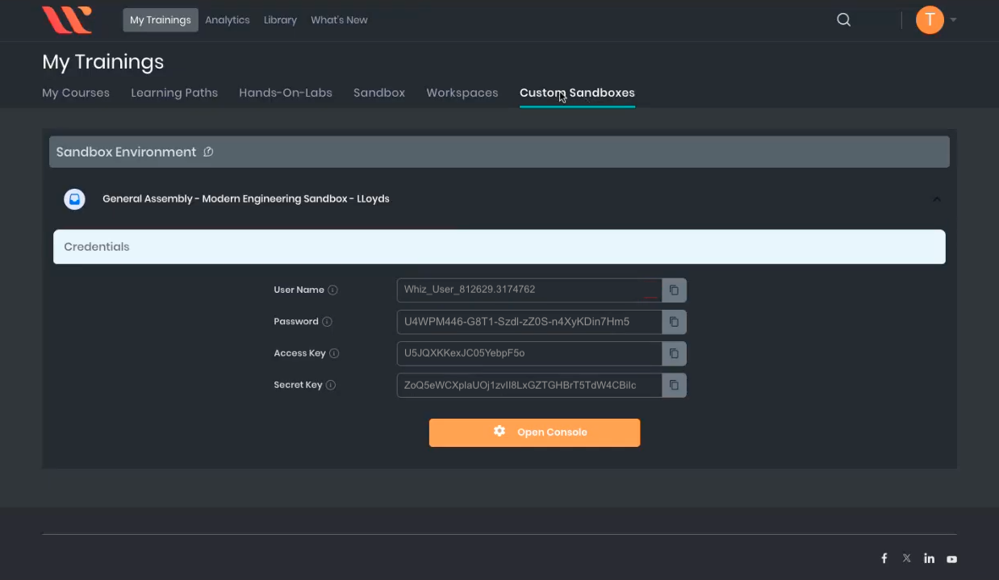

<h1>
  <span class="headline">Infrastructure As Code: Ansible & Terraform</span>
  <span class="subhead">Getting Started with Terraform</span>
</h1>

**Learning objective:** By the end of this lesson, learners will be able to use Terraform to define, deploy, and manage a simple DynamoDB instance in AWS.

## Confirm Terraform installation

In this section we'll explore Terraform, a powerful tool for automating infrastructure as code.

Terraform runs on Linux, Windows, or macOS. You can download and install it by following the instructions at [Terraform Downloads](https://developer.hashicorp.com/terraform/downloads).

> If you ran the Ansible `playbook.yml` on your Amazon Workspace VM from the previous session, Terraform has already been installed for you using an Ansible script.

To confirm that Terraform is installed, open your terminal and run:

```bash
terraform -v
```

You should see output similar to:

```bash
Terraform v1.8.5
on linux_amd64
+ provider registry.terraform.io/hashicorp/aws v4.67.0
+ provider registry.terraform.io/hashicorp/random v3.6.2
```

Each time you use Terraform, there are simple steps to follow. In this lesson, you will learn these basic steps by creating a DynamoDB instance. This hands-on practice will help you understand how to start working with Terraform templates.

## Configuring AWS credentials

First things first. Before Terraform can interact with AWS services, you need to configure your AWS credentials. This allows us to connect to AWS from the CLI.

### Get AWS access keys from Whizlabs

> **_Pro tip: Log in to Whizlabs from your Amazon Workspace VM. The AWS Access Keys are very long and complex. You should copy and paste them directly from the browser into your terminal. Do not attempt to type them manually—typos are almost guaranteed and will cause authentication failures, requiring you to repeat this step._**

#### 1. On your Amazon Workspace virtual machine, open a web browser.

#### 2. Navigate to the Whizlabs training dashboard: [https://business.whizlabs.com/learn/my-training/](https://business.whizlabs.com/learn/my-training/)

- You'll find the access keys you need in your **Whizlabs Custom Sandbox**.

- Once the sandbox environment loads, you should see your `AWS Access Key ID` and `AWS Secret Access Key` displayed on the screen.
- These credentials are required for configuring your AWS CLI.

<br>



<br>

#### 3. Back in your terminal window type:

```bash
aws configure
```

#### 4. You will be prompted to enter your AWS credentials and default region settings...

```plaintext
*** Example Only ***

[your-workstation-987541-1235qa-c80z56]$  aws configure
AWS Access Key ID [None]:  AKIAJWTHXU9P44LFQMLK
AWS Secret Access Key [None]:  bXrTqVyW9nJ784Tp5PLMSxwruNYdCR3kOzFpAZEm
Default region name [None]:  us-east-1
Default output format [None]:
[your-workstation-987541-1235qa-c80z56]$
```

> **_Copy and Paste: The access keys are long and complex. Avoid typing them manually to prevent errors._**

#### 5. Verify Your Configuration

If you think you entered an incorrect value you can check your AWS config file by typing the command:

```bash
cat ~/.aws/credentials
```

This will print the contents of your `.aws` config file to your terminal so that you can verify the correct values were entered:

```bash
aws_access_key_id = YOUR_ACCESS_KEY_ID
aws_secret_access_key = YOUR_SECRET_ACCESS_KEY
...
```

Ensure that both the `Access Key ID` and `Secret Access Key` match the ones provided by Whizlabs.

If there is an error you can reenter the credentials by typing:

```bash
aws configure
```

and completing the process again.

## Creating the Terraform manifest

Now, let's create a Terraform manifest to deploy an AWS DynamoDB instance as a demo. This will give you hands-on experience creating infrastructure with Terraform.

### 1. Navigate to the `Desktop` on your workstation and create a new directory.

```bash
cd ~/Desktop
mkdir terraform-demo-01
cd terraform-demo-01
```

### 2. Create the Terraform File

Create and open a new file called `main.tf` using VS Code:

```bash
code main.tf
```

### Creating the Manifest

In Terraform, a **manifest** is a file that contains configuration code specifying the desired infrastructure. To begin, you'll define two key blocks in the `main.tf` file:

- A `terraform` block to specify the Terraform version and the required provider (in this case, AWS).

- A `provider` block to configure the provider settings, such as the AWS region where your infrastructure will be deployed.

Copy and paste the following information inside `main.tf` file:

```plaintext
terraform {
  required_providers {
    aws = {
      source  = "hashicorp/aws"
      version = "~> 4.16"
    }
  }

  required_version = ">= 1.2.0"
}

provider "aws" {
  region  = "us-east-1"
}
```

Save this file and exit `VS Code`.

> _Syntax Errors?_ If your file shows syntax errors, first verify that Terraform is installed by running `terraform -v` in your terminal. If it's installed, try closing and reopening VS Code to ensure Terraform syntax highlighting loads correctly.

## Initializing Terraform

Back in your terminal make sure you are still in the same directory as your `main.tf` file and run the following command:

```bash
terraform init
```

You should see output indicating that Terraform has been successfully initialized:

```text
Initializing the backend...
Initializing provider plugins...
- Finding hashicorp/aws versions matching "~> 4.16"...
- Installing hashicorp/aws v4.67.0...
- Installed hashicorp/aws v4.67.0 (signed by HashiCorp)
Terraform has created a lock file .terraform.lock.hcl to record the provider
selections it made above. Include this file in your version control repository
so that Terraform can guarantee to make the same selections by default when
you run "terraform init" in the future.

Terraform has been successfully initialized!

You may now begin working with Terraform. Try running "terraform plan" to see
any changes that are required for your infrastructure. All Terraform commands
should now work.

If you ever set or change modules or backend configuration for Terraform,
rerun this command to reinitialize your working directory. If you forget, other
commands will detect it and remind you to do so if necessary.
```

<blockquote class="attention">
⚠️  Warning: If you encounter any errors, please ask your instructor for assistance before proceeding.
</blockquote>

## Terraform Plan

Once you've initialized your Terraform directory, you can start to add **resource blocks**, plan, and apply them.

### 1. Add resource blocks

Open your `main.tf` and copy and paste the following resource blocks at the end of the manifest file:

```plaintext
resource "aws_dynamodb_table" "accounts" {
  name         = "Accounts"
  billing_mode = "PAY_PER_REQUEST"
  hash_key     = "id"

  attribute {
    name = "id"
    type = "S"
  }

  tags = {
    Name = "AccountsTable"
  }
}
```

A **_resource block_** in Terraform defines a specific infrastructure component you want to create or manage, such as an _AWS DynamoDB table_, an _S3 bucket_, or a _virtual machine_. The example above specifies the creation of a DynamoDB table named "Accounts," its configuration (like billing mode and key attributes), and optional tags for organization.

### 2. Plan the infrastructure

In your terminal, run:

```bash
terraform plan
```

- Terraform will analyze your configuration and show you what actions it will take _without_ making any changes yet.
- If you receive an error, try running `terraform init` again and then rerun `terraform plan`.

You should see output of Terraform telling you what it _would_ do

## Terraform Apply

Now its time to deploy the infrastructure!

### 3. Apply the configuration

Run the following command to create the DynamoDB table:

```bash
terraform apply
```

When prompted with `Do you want to perform these actions?`, type `yes` and press <kbd>Enter</kbd>:

```plaintext
Do you want to perform these actions?
Terraform will perform the actions described above.
Only ‘yes’ will be accepted to approve.

Enter a value: yes

aws_dynamodb_table.accounts: Creating...
aws_dynamodb_table.accounts: Creation complete after 6s [id=Accounts]

Apply complete! Resources: 1 added, 0 changed, 0 destroyed.
[your-workstation-987541-1235qa-c80z56 terraform-demo-01]$
```

### Verify the Deployment

Visit the **DynamoDB** service in the **AWS management console** and verify that the database was created

#### Confirm no further changes

Run `terraform plan` again. You should see it tell you there is nothing it needs to do.

```bash
terraform plan
```

## Terraform Destroy

It's important to clean up resources after these exercises to avoid unnecessary charges. Let's practice removing resources by destroying the DynamoDB Database we just created.

### 4. Destroy the Infrastructure

Run the following to destroy the infrastructure you made:

```bash
terraform destroy -auto-approve
```

Visit the DynamoDB service in the AWS management console and verify that the database was deleted.

## Wrap up

Congratulations! You just used terraform to create a DynamoDB instance on the AWS cloud!

Here is a wrap up overview of the actions used in this section:

| **Action**     | **Description**                              | **Command**         |
| -------------- | -------------------------------------------- | ------------------- |
| **Initialize** | Set up a Terraform workspace.                | `terraform init`    |
| **Plan**       | Preview infrastructure changes.              | `terraform plan`    |
| **Apply**      | Create resources based on the configuration. | `terraform apply`   |
| **Destroy**    | Remove resources no longer needed.           | `terraform destroy` |
