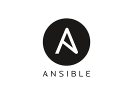
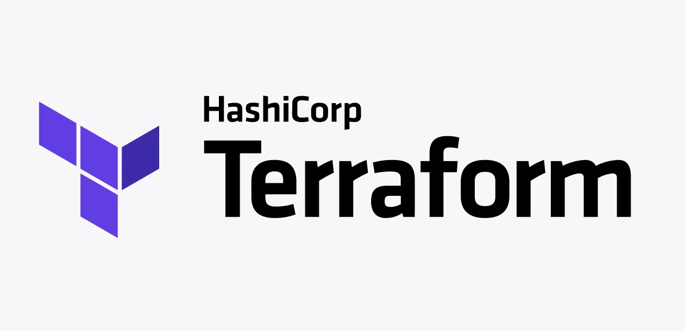

<h1>
  Infrastructure As Code: Ansible & Terraform
  Intro to Ansible and Terraform
</h1>

**Learning objective:** By the end of this lesson, learners will be able to describe the purpose of Ansible and Terraform, understand the difference between configuration management and infrastructure-as-code (IaC), and explain how these tools complement each other in cloud environments.

## Setting the stage

### The evolution of automation in IT

In the early days of IT, managing servers, networks, and applications was largely manual. Tasks like installing software, configuring systems, and scaling resources became increasingly time-consuming as infrastructures grew.

> This challenge gave rise to **Configuration Management (CM)** tools like Puppet, Chef, and Ansible.

Later, as cloud computing became prevalent, the focus shifted to automating the creation and management of entire infrastructures.

> This new approach, known as **Infrastructure-as-Code (IaC)**, allows engineers to define infrastructure through code, enabling better scalability, consistency, and version control.

## Configuration Management (CM)

### Automating system states

Configuration management focuses on ensuring that servers and devices reach and maintain a **desired state**. For example, it can automate tasks like installing software or configuring a web server.

### Key features of CM tools

| **Feature**                   | **Description**                                                                                                                                                       |
| ----------------------------- | --------------------------------------------------------------------------------------------------------------------------------------------------------------------- |
| **Origins**                   | CM tools predate cloud environments and were widely used in traditional data centers.                                                                                 |
| **Focus**                     | Primarily used to bring individual systems to a specific, desired state.                                                                                              |
| **Examples of Tools**         | [Ansible](https://www.ansible.com/), [Puppet](https://www.puppet.com/), [Chef](https://www.chef.io/products/chef-infra), [Salt](https://saltproject.io/) |
| **Agent-Based vs. Agentless** | - **Agent-Based**: Tools like Puppet and Chef use agents installed on servers. - **Agentless**: Tools like Ansible interact directly with servers over SSH.        |

### Why does configuration management matter?

Installing software or configuring _one_ server is manageable. Doing it for _thousands_ of servers? Not so much. That’s when we realize we need a way to automate things.

## Infrastructure-as-Code (IaC)

### Automating Infrastructure Creation

When cloud computing introduced dynamic, scalable resources, a new problem emerged: how do you consistently create and manage these resources at scale? IaC tools like Terraform stepped in to solve this problem.

### Key Features of IaC Tools

| **Feature**           | **Description**                                                                                                                                                                   |
| --------------------- | --------------------------------------------------------------------------------------------------------------------------------------------------------------------------------- |
| **Declarative**       | You define the desired state of infrastructure, and the tool determines how to achieve it.                                                                                        |
| **Version Control**   | Infrastructure definitions are stored as code, enabling tracking, review, and rollbacks.                                                                                          |
| **Examples of Tools** | [Terraform](https://www.terraform.io/), [Pulumi](https://www.pulumi.com/), and [AWS CloudFormation](https://docs.aws.amazon.com/AWSCloudFormation/latest/UserGuide/Welcome.html). |

### Why does IaC matter?

IaC allows you to automate tasks like provisioning servers, networks, and storage in a consistent, repeatable way. This improves reliability and saves time, especially in cloud environments.

## Introducing Ansible

 

 

### Automating configuration

[**Ansible**](https://www.ansible.com/) is a lightweight, agentless CM tool used to configure systems and automate tasks on servers.

### Features:

- **Agentless**: Communicates directly with nodes over SSH.
- **Simple Syntax**: Uses `YAML` for **_playbooks_**, making it beginner-friendly.
- **Common Use Cases**: Installing software, managing configurations, and handling system updates.

### Use case

After provisioning a SQL database with Terraform, you can use Ansible to define and automate the creation of tables and columns. This ensures consistency and reduces the risk of manual errors.

## Introducing Terraform

 

 

### Automating infrastructure creation

[**Terraform**](https://www.terraform.io/) is an open-source IaC tool that allows you to define and provision cloud infrastructure through code.

### Features:

- **Declarative Approach**: Specify the desired end state, and Terraform determines the steps to achieve it.
- **Extensibility**: Supports all major cloud platforms (**AWS**, **Azure**, **GCP**) through plugins.
- **State Management**: Tracks the state of your infrastructure, enabling updates and rollbacks.
- **Syntax & Languages**: Uses `HCL` (HashiCorp Configuration Language) for writing infrastructure definitions, with optional support for `JSON`.

### Use case

You can use Terraform to provision an entire cloud environment, including servers, databases, and networks, in a single, repeatable process.

## How Ansible and Terraform work together

While both Ansible and Terraform automate tasks, they serve different purposes:

- **Terraform**: Focuses on creating and managing infrastructure (ex: provisioning servers, networks, and storage).

- **Ansible**: Focuses on configuring and managing the systems and applications running on that infrastructure.

Together, these tools streamline the process of building, configuring, and managing scalable cloud environments.

## Advantages and disadvantages

| **Tool**            | **Advantages**                                                                                                        | **Disadvantages**                                                                                                     |
| ------------------- | --------------------------------------------------------------------------------------------------------------------- | --------------------------------------------------------------------------------------------------------------------- |
| **Terraform (IaC)** | - Infrastructure is version-controlled. - Automates large-scale provisioning. - Enables rollbacks and auditing. | - Less suited for quick, one-off changes. - Team collaboration may require additional tools (ex: Terraform Cloud). |
| **Ansible (CM)**    | - Quick to set up and use. - Does not require agents on managed systems.                                           | - May not scale as well as agent-based tools for very large environments.                                             |

> Ansible and Terraform are essential tools in modern software engineering. Terraform handles infrastructure provisioning, while Ansible focuses on configuration and automation. By combining their strengths, you can build, manage, and scale cloud environments efficiently and reliably.
